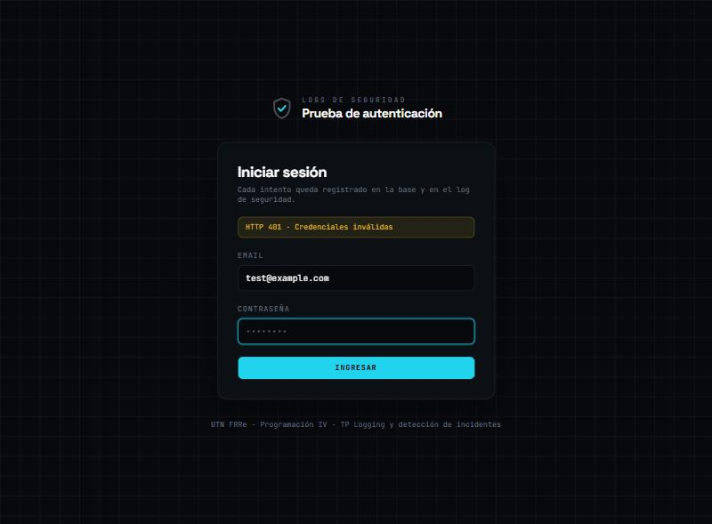

# Logging y detección de incidentes de seguridad en Laravel

Trabajo práctico de **Programación IV** (UTN FRRe, cohorte 2026).

Aplicación con un **login propio** que registra cada intento de autenticación en la base de datos y en un log de seguridad independiente, detecta intentos reiterados desde una IP, la bloquea temporalmente y muestra la evidencia en un panel solo para administradores.

📄 **[Informe completo](docs/INFORME.md)**: pruebas, consultas, análisis y comparación con el TP sobre proyecto iniciado.

## Reglas de detección

| Condición (por IP, 5 minutos) | Respuesta |
|---|---|
| Autenticación correcta | `INFO` y evento `success` · HTTP 200 |
| 1–2 fallos | `WARNING` y evento `failed` · HTTP 401 |
| 3–4 fallos | `ALERT` por posible fuerza bruta |
| 5 fallos | Bloqueo de 10 minutos y `CRITICAL` |
| IP bloqueada | HTTP 429 y evento `blocked` |

### Mejoras (actividad integradora)

- **Detección por cuenta:** también se cuentan los fallos contra la misma cuenta desde cualquier IP (15 minutos). Con 3 hay alerta y con 5 la cuenta se bloquea 10 minutos para todas las IPs. Detecta ataques distribuidos.
- **Exportación de evidencias:** botón *Exportar CSV* en el panel, solo para administradores. Cada descarga queda registrada en el log.

## Entorno usado

| | |
|---|---|
| Sistema operativo | Windows 11 Pro |
| PHP | 8.3 |
| Laravel | 13 |
| Base de datos | SQLite |

## Cómo correrlo

```bash
composer install
cp .env.example .env
php artisan key:generate
php artisan migrate --seed
npm install
npm run build
php artisan serve
```

Abrir http://127.0.0.1:8000/security-login.

`--seed` crea dos usuarios de prueba (contraseña `password` en ambos):

| Usuario | Rol | Puede ver el panel |
|---|---|---|
| `test@example.com` | Administrador | Sí |
| `comun@example.com` | Común | No (recibe 403) |

### Rutas

| Ruta | Acceso | Qué hace |
|---|---|---|
| `GET /security-login` | Invitados | Formulario de login |
| `POST /security-login` | Invitados | Autentica y aplica las reglas; responde JSON (200 / 401 / 429) |
| `POST /security-logout` | Usuarios logueados | Cierra la sesión |
| `GET /security-dashboard` | Solo administradores | Panel de seguridad |
| `GET /security-dashboard/export` | Solo administradores | Descarga de evidencias en CSV |

### Logs

```bash
# Linux / Git Bash
tail -f storage/logs/security-*.log
grep -E "ALERT|CRITICAL" storage/logs/security-*.log
```

```powershell
# PowerShell
Get-Content storage\logs\security-*.log -Wait
Select-String -Path storage\logs\security-*.log -Pattern "ALERT|CRITICAL"
```

### Tests

```bash
php artisan test
```

Automatizan las pruebas obligatorias del enunciado (incluida la de "después de 10 minutos", adelantando el reloj), los permisos del panel y las dos mejoras: 22 tests.

## Estructura

| Parte | Archivo |
|---|---|
| Canal de logs | `config/logging.php` (canal `security`) |
| Tabla de auditoría | `database/migrations/..._create_login_attempts_table.php` |
| Login y reglas | `app/Http/Controllers/SecurityLoginController.php` |
| Panel | `app/Http/Controllers/SecurityDashboardController.php` |
| Permiso | `app/Providers/AppServiceProvider.php` (Gate `viewSecurityDashboard`) |
| Vistas | `resources/views/security-login.blade.php`, `security-dashboard.blade.php` |
| Tests | `tests/Feature/SecurityLoginTest.php`, `tests/Feature/SecurityImprovementsTest.php` |

## Capturas

#### Login con respuesta del servidor



<!-- CAPTURA DEL PANEL -->
