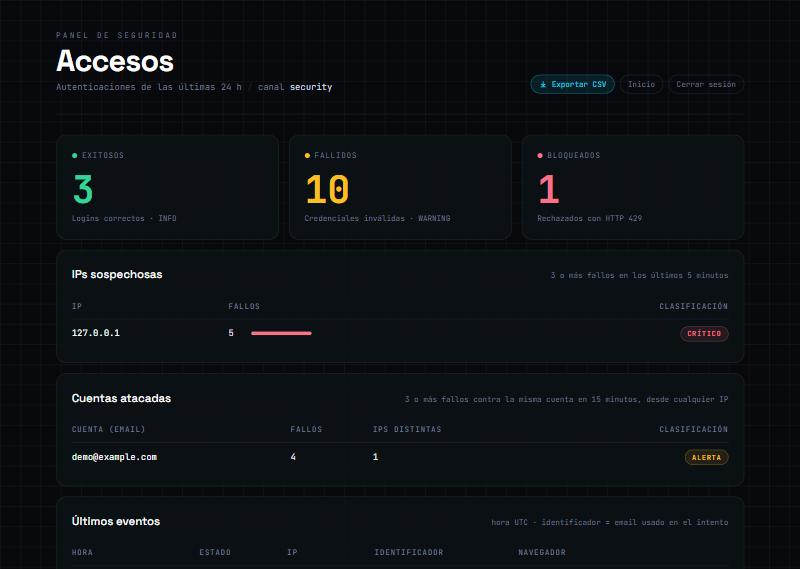

# Informe · Logging y detección de incidentes de seguridad en Laravel

Proyecto nuevo con un **controlador de login propio** que registra cada intento de autenticación, detecta patrones sospechosos, aplica un bloqueo temporal y muestra la evidencia en un panel protegido.

- **Laravel:** 13.40.0 · **PHP:** 8.3 · **Base de datos:** SQLite · **Caché:** `database`
- **Repositorio del TP sobre proyecto iniciado (comparación):** [Monitor-de-servidor](https://github.com/MatiasDN19/Monitor-de-servidor)

## 1. Reglas de detección

| Condición (por IP, 5 minutos) | Respuesta |
|---|---|
| Autenticación correcta | `INFO` y evento `success` · HTTP 200 |
| 1–2 fallos | `WARNING` y evento `failed` · HTTP 401 |
| 3–4 fallos | `ALERT` por posible fuerza bruta · HTTP 401 |
| 5 fallos | Bloqueo de 10 minutos y `CRITICAL` · HTTP 401 |
| IP bloqueada | HTTP 429 y evento `blocked` |

## 2. Implementación

| Archivo | Qué hace |
|---|---|
| `.env` / `.env.example` | `LOG_CHANNEL=daily`, `LOG_LEVEL=debug`, `CACHE_STORE=database`, `APP_DEBUG=true` (solo desarrollo) |
| `config/logging.php` | Canal `security`: diario, nivel `info`, 30 archivos |
| `database/migrations/..._create_login_attempts_table.php` | Tabla de auditoría con índice `(ip_address, status, created_at)` |
| `app/Models/LoginAttempt.php` | Modelo de la tabla |
| `app/Http/Controllers/SecurityLoginController.php` | Valida, autentica, registra y aplica las reglas |
| `routes/web.php` | `GET`/`POST /security-login` (`guest`), `POST /security-logout`, `GET /security-dashboard` (`auth` + `can:viewSecurityDashboard`) |
| `resources/views/security-login.blade.php` | Formulario con `@csrf`; muestra la respuesta JSON del servidor |
| `database/migrations/..._add_is_admin_to_users_table.php` | Rol mínimo de administrador |
| `app/Providers/AppServiceProvider.php` | Gate `viewSecurityDashboard` |
| `app/Http/Controllers/SecurityDashboardController.php` | Indicadores de 24 h, IPs sospechosas y últimos eventos |
| `tests/Feature/SecurityLoginTest.php` | Las pruebas obligatorias automatizadas |
| `database/migrations/..._add_identifier_index_to_login_attempts_table.php` | Índice para la detección por cuenta (mejora 1) |
| `tests/Feature/SecurityImprovementsTest.php` | Tests de las dos mejoras |

### Diferencias con el enunciado

- **`max_files` en lugar de `days`** en el canal diario: es el nombre actual de la opción en Laravel 13 (la clave anterior sigue funcionando).
- **La ruta `GET /security-login` se llama `login`.** El middleware `auth` del panel redirige a los invitados a la ruta llamada `login`; sin ese nombre, entrar al panel sin sesión daría un error en lugar de redirigir.
- **La raíz `/`** redirige al formulario si no hay sesión y muestra la sesión activa si la hay. El middleware `guest` manda a los usuarios logueados a `/`; si `/` redirigiera siempre al login, se formaría un bucle.
- **Se agregó `POST /security-logout`** para poder cambiar de usuario durante las pruebas (administrador y usuario común).
- **Gate con columna `is_admin`**, que no es asignable en masa (no figura en `Fillable` del modelo `User`), para que nadie pueda hacerse administrador desde un formulario.
- **Consultas en sintaxis SQLite** (`datetime('now', '-5 minutes')`) en lugar de MySQL (`NOW() - INTERVAL 5 MINUTE`).
- **El formulario envía con `fetch`** y muestra el código HTTP y el mensaje del JSON. Sin JavaScript funciona igual como formulario común.

## 3. Pruebas obligatorias

Se partió de la tabla vacía y un log nuevo. Todas las pruebas se hicieron en local con el usuario de prueba `test@example.com`.

| # | Prueba | Resultado esperado | Resultado obtenido |
|---|---|---|---|
| 1 | Login válido | INFO y registro `success` | ✅ HTTP 200 `Autenticación correcta` · `INFO Inicio de sesión exitoso` |
| 2 | Dos contraseñas incorrectas | Dos eventos WARNING | ✅ 2 × HTTP 401 · 2 × `WARNING Autenticación fallida` (1 y 2 fallos) |
| 3 | Tres fallos en cinco minutos | Alerta por posible fuerza bruta | ✅ En el 3.er fallo: `ALERT Posible ataque de fuerza bruta {"failed_attempts":3}` |
| 4 | Cinco fallos en cinco minutos | Bloqueo 10 minutos y CRITICAL | ✅ En el 5.º fallo: `CRITICAL Bloqueo temporal por intentos fallidos {"duration_minutes":10}` |
| 5 | Acceso mientras la IP está bloqueada | HTTP 429 y registro `blocked` | ✅ HTTP **429** aun con la contraseña correcta · `WARNING Intento desde IP bloqueada` · fila `blocked` |
| 6 | Acceso tras vencer el bloqueo | Autenticación habilitada nuevamente | ✅ A las 04:30:34 (bloqueo desde 04:19:49): HTTP 200 `Autenticación correcta` · `INFO Inicio de sesión exitoso` |

Además, las mismas pruebas están automatizadas en `tests/Feature/SecurityLoginTest.php`. La prueba 6 se automatiza adelantando el reloj 11 minutos con `$this->travel(11)->minutes()`. Se ejecutan con `php artisan test` (22 tests en total, todos pasan).

### Log generado (`storage/logs/security-2026-11-05.log`, horas en UTC)

Copia completa en [`evidencias/security-2026-11-05.log`](evidencias/security-2026-11-05.log).

```
[2026-11-05 04:19:45] local.INFO: Inicio de sesión exitoso {"user_id":1,"ip":"127.0.0.1"}                       ← prueba 1 (HTTP 200)
[2026-11-05 04:19:46] local.WARNING: Autenticación fallida {"ip":"127.0.0.1","failed_attempts":1}                  ← prueba 2 (HTTP 401)
[2026-11-05 04:19:46] local.WARNING: Autenticación fallida {"ip":"127.0.0.1","failed_attempts":2}                  ← prueba 2 (HTTP 401)
[2026-11-05 04:19:47] local.WARNING: Autenticación fallida {"ip":"127.0.0.1","failed_attempts":3}                  ← prueba 3
[2026-11-05 04:19:47] local.ALERT: Posible ataque de fuerza bruta {"ip":"127.0.0.1","failed_attempts":3}          ← prueba 3 (alerta)
[2026-11-05 04:19:48] local.WARNING: Autenticación fallida {"ip":"127.0.0.1","failed_attempts":4}
[2026-11-05 04:19:48] local.ALERT: Posible ataque de fuerza bruta {"ip":"127.0.0.1","failed_attempts":4}
[2026-11-05 04:19:49] local.WARNING: Autenticación fallida {"ip":"127.0.0.1","failed_attempts":5}                  ← prueba 4
[2026-11-05 04:19:49] local.CRITICAL: Bloqueo temporal por intentos fallidos {"ip":"127.0.0.1","failed_attempts":5,"duration_minutes":10}  ← prueba 4 (bloqueo)
[2026-11-05 04:19:50] local.WARNING: Intento desde IP bloqueada {"ip":"127.0.0.1"}                                 ← prueba 5 (HTTP 429)
[2026-11-05 04:30:34] local.INFO: Inicio de sesión exitoso {"user_id":1,"ip":"127.0.0.1"}                       ← prueba 6 (HTTP 200)
```

Las pruebas 1 a 5 se ejecutaron antes de agregar la detección por cuenta (mejora 1); por eso el log no tiene eventos de cuenta. Esa mejora se verifica con sus tests automáticos.

## 4. Resultados de las consultas

```sql
-- Últimos eventos
SELECT * FROM login_attempts ORDER BY created_at DESC LIMIT 20;
```

| id | identifier | ip_address | status | created_at (UTC) |
|---|---|---|---|---|
| 6 | test@example.com | 127.0.0.1 | failed | 2026-11-05 04:19:49 |
| 7 | test@example.com | 127.0.0.1 | blocked | 2026-11-05 04:19:49 |
| 5 | test@example.com | 127.0.0.1 | failed | 2026-11-05 04:19:48 |
| 4 | test@example.com | 127.0.0.1 | failed | 2026-11-05 04:19:47 |
| 2 | test@example.com | 127.0.0.1 | failed | 2026-11-05 04:19:46 |
| 3 | test@example.com | 127.0.0.1 | failed | 2026-11-05 04:19:46 |
| 1 | test@example.com | 127.0.0.1 | success | 2026-11-05 04:19:45 |

**Observación:** varios eventos ocurren en el mismo segundo y la consulta ordena solo por `created_at`, así que entre ellos el orden no está garantizado (el 6 aparece antes que el 7). En el panel se ordena también por `id` para respetar el orden real.

```sql
-- Fallos acumulados por IP
SELECT ip_address, COUNT(*) AS total_fallos FROM login_attempts
WHERE status = 'failed' GROUP BY ip_address ORDER BY total_fallos DESC;
```

| ip_address | total_fallos |
|---|---|
| 127.0.0.1 | 5 |

```sql
-- IPs sospechosas (SQLite)
SELECT ip_address, COUNT(*) AS total_fallos FROM login_attempts
WHERE status = 'failed' AND created_at >= datetime('now', '-5 minutes')
GROUP BY ip_address HAVING COUNT(*) >= 3;
```

| ip_address | total_fallos |
|---|---|
| 127.0.0.1 | 5 |

## 5. Panel de monitoreo

`/security-dashboard` muestra los totales `success`, `failed` y `blocked` de las últimas 24 horas, las IPs con 3 o más fallos en 5 minutos (*Alerta* o *Crítico*) y los últimos eventos. Se actualiza solo cada 10 segundos.

| Quién | Resultado |
|---|---|
| Invitado | 302 → `/security-login` |
| Usuario común (`comun@example.com`) | **403** |
| Administrador (`test@example.com`) | 200 |

Captura tomada después de las pruebas (04:35 UTC), con fallos de demostración contra `demo@example.com` desde la misma IP: la IP aparece como **Crítico** (5 fallos, bloqueada) y la cuenta en **Alerta** por la detección por cuenta (mejora 1).



## 6. Comparación con el TP sobre proyecto iniciado

| | Proyecto iniciado (Monitor) | Proyecto nuevo (este) |
|---|---|---|
| Login | Breeze, **sin modificarlo** | Controlador propio |
| Dónde se registra | Listener de eventos `Login` / `Failed` | Dentro del controlador |
| Dónde se detecta y bloquea | Middleware **antes** del login | Controlador **después** de registrar el fallo |
| Momento del bloqueo | El 5.º fallo pasa; el **6.º intento** se bloquea | El **5.º fallo** ya activa el bloqueo |
| Identificador guardado | Hash SHA-256 del email | Email en texto plano |
| Respuesta | Redirección con error (formulario) | JSON con 200 / 401 / 429 |

**Conclusiones:**

- Con un controlador propio todo queda en un solo lugar y es más fácil de seguir, pero mezcla responsabilidades (autenticar, auditar y bloquear) y hay que reescribirlo si cambia el login. El enfoque con eventos y middleware no toca el login existente y se puede sumar a cualquier proyecto.
- Guardar el email en claro facilita la investigación (se ve qué cuenta fue atacada), pero expone datos personales si alguien accede a la tabla o a una exportación. El hash protege el dato y sigue permitiendo agrupar intentos de una misma cuenta. Para una auditoría real conviene el hash o, al menos, restringir y cifrar el acceso a la tabla.

## 7. Análisis y decisiones de seguridad

<!-- Revisar y escribir con palabras propias -->

**¿Qué IP concentra los fallos?**
127.0.0.1, con 5 fallos en 4 segundos contra la misma cuenta (`test@example.com`).

**¿Puede afirmarse que existe un ataque?**
No con certeza. El patrón (fallos seguidos, a un segundo de distancia, desde un cliente automatizado) es compatible con fuerza bruta, pero también con un usuario que no recuerda su contraseña o un script mal configurado. El registro permite detectar un comportamiento sospechoso, no probar intención.

**¿Qué efectos tendría bloquear una IP compartida?**
Detrás de una IP pública puede haber muchas personas (universidad, empresa, CGNAT de un proveedor, red móvil). El bloqueo deja afuera a todas durante 10 minutos por los fallos de una, y un atacante podría provocarlo a propósito. Por eso conviene combinar límites por IP con límites por cuenta.

**¿Qué evidencias adicionales se necesitan?**
- Cuántas cuentas distintas se intentaron desde la misma IP (*password spraying*).
- Si la misma cuenta recibe fallos desde muchas IPs (ataque distribuido).
- El `user_agent`: clientes automatizados (`curl`, scripts) frente a navegadores.
- Si hubo un login exitoso después de la serie de fallos (posible cuenta comprometida).
- Horario y frecuencia comparados con el uso normal; reputación o geolocalización de la IP.

**¿Qué respuestas conviene automatizar?**
- *Automáticas:* registrar todo, alertar al superar umbrales, bloqueos temporales cortos que se levantan solos.
- *Con revisión humana:* bloqueos permanentes, deshabilitar cuentas, confirmar si hubo un incidente y avisar a los usuarios afectados.

## 8. Actividad integradora: dos mejoras

### Mejora 1 · Detección por cuenta

**Problema.** Las reglas por IP no detectan un ataque **distribuido**: si cada intento llega desde una IP distinta, ninguna llega a 5 fallos y la cuenta puede ser atacada sin límite.

**Implementación.** Después de registrar un fallo, el controlador cuenta también los fallos contra la **misma cuenta** (`identifier`) desde **cualquier IP** en los últimos **15 minutos** (ventana más larga que la de IP, porque los ataques distribuidos suelen ser más lentos):

| Fallos contra la cuenta (15 min) | Respuesta |
|---|---|
| 3 o 4 | `ALERT Posible ataque dirigido a una cuenta` (con cantidad de IPs distintas) |
| 5 | Cuenta bloqueada 10 minutos · `CRITICAL Bloqueo temporal de cuenta` |
| Cuenta bloqueada | HTTP 429 desde cualquier IP · `WARNING Intento contra cuenta bloqueada` · fila `blocked` |

- Índice `(identifier, status, created_at)` en una migración nueva.
- El panel suma la tabla **Cuentas atacadas** con fallos e **IPs distintas**; con 2 o más se marca *distribuido*.
- El bloqueo de una cuenta no afecta a las demás.

**Interacción con las reglas por IP.** Al agregar la mejora falló un test existente: 5 fallos contra una cuenta desde una IP y luego login con la misma cuenta desde otra IP. Antes entraba; ahora la cuenta también está bloqueada. Es el comportamiento buscado, y el test se ajustó para probar el aislamiento entre IPs con otra cuenta.

**Trade-off.** Un atacante podría bloquear a propósito la cuenta de otra persona fallando 5 veces (denegación de servicio dirigida). Por eso el bloqueo es corto y temporal.

### Mejora 2 · Exportación de evidencias

**Problema.** Para analizar un incidente con otras herramientas o entregarlo como evidencia hace falta sacar los datos de forma ordenada.

**Implementación.** Botón **Exportar CSV** en el panel (`GET /security-dashboard/export`), con la misma protección `auth` + `can:viewSecurityDashboard`. Descarga todos los intentos (id, fecha UTC, estado, IP, email, navegador).

- `streamDownload` + `lazy()`: se escribe por partes, sin cargar toda la tabla en memoria.
- BOM UTF-8 para que Excel muestre bien los caracteres.
- **Cada exportación queda registrada**: `NOTICE Exportación de evidencias` con usuario, IP y cantidad de filas. Como el CSV contiene emails en claro, saber quién lo descargó es parte de la auditoría.

### Tests de las mejoras

`tests/Feature/SecurityImprovementsTest.php` (8 tests): ataque distribuido que bloquea la cuenta, 3 fallos que no bloquean, bloqueo aislado por cuenta, vencimiento a los 10 minutos, panel con la cuenta *distribuida*, y exportación para invitado (→ login), usuario común (403) y admin (CSV con los datos). En total, 22 tests pasan.

## 9. Seguridad y límites de la implementación

- El bloqueo no es atómico: muchas solicitudes simultáneas pueden pasar antes de que se cuenten los fallos. En producción se usaría `RateLimiter` sobre Redis.
- La detección por cuenta cubre ataques distribuidos contra una cuenta, pero no el *password spraying* (una contraseña probada contra muchas cuentas, con pocos intentos en cada una).
- `$request->ip()` detrás de un proxy o balanceador devuelve la IP del proxy: hay que configurar proxies confiables.
- `APP_DEBUG=true` es solo para desarrollo; en producción debe ser `false`.
- El email en claro en `login_attempts` requiere una política de retención y acceso restringido.
- Los logs técnicos no reemplazan una auditoría íntegra (firmada o en almacenamiento de solo escritura).
